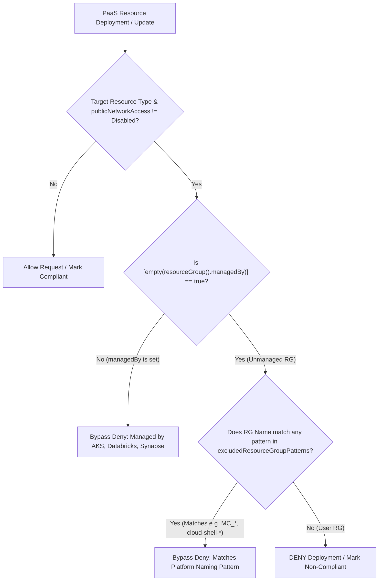

# Azure Policy: Private-Only PaaS Enforcement with Platform Managed RG Bypass

This folder contains a production-ready Azure Policy definition, rule/parameter files, and Infrastructure-as-Code (Bicep and Terraform) deployment templates.

It enforces that all core PaaS resources strictly have **public network access disabled** (`publicNetworkAccess: Disabled`), while intelligently exempting background platform infrastructure provisioned by first-party Azure managed services (such as **Azure Databricks**, **Azure Kubernetes Service (AKS)**, **Azure Synapse Analytics**, and **Azure Cloud Shell**).

---

## 1. Problem Statement & Root Cause

When organizations enforce a zero-trust network perimeter, they deploy an Azure Policy with a `Deny` effect on any resource where `publicNetworkAccess != "Disabled"`. 

However, this policy causes deployment failures for first-party Azure services:
* **Azure Databricks:** During workspace creation, Databricks creates a backend managed resource group (e.g., `databricks-rg-*`) and provisions internal DBFS root storage accounts (`dbstorage...`), NSGs, and virtual networks. If the storage account cannot be created with public network access, workspace deployment immediately aborts.
* **Azure Kubernetes Service (AKS):** When provisioning clusters or node pools, AKS deploys into a managed resource group (e.g., `MC_<rg>_<cluster>_<region>`). Auxiliary storage, public IPs, and load balancers are evaluated against policies during cluster scale-up/creation.
* **Azure Synapse:** Provisions internal managed resource groups and managed storage accounts.
* **Azure Cloud Shell:** Automatically provisions a user-scoped storage account in a resource group named `cloud-shell-storage-<region>` when a user opens the Azure Cloud Shell.
* **Azure Backup & Diagnostics:** Services provisioning temporary or operational storage into system-created resource groups like `AzureBackupRG_*`.

### Why Traditional Policy Solutions Fail
1. **Assignment `notScopes` cannot use wildcards:** The `notScopes` property on policy assignments only accepts explicit, fully-qualified resource group IDs. It **does not support wildcard matching** (like `*/resourceGroups/MC_*`). Because AKS and Databricks generate these resource groups dynamically on-demand, they cannot be pre-excluded.
2. **Policy Exemptions cannot preempt dynamic creation:** An Azure Policy Exemption (`Microsoft.Authorization/policyExemptions`) can only be created against an *already existing* resource group. When a service provisions backend infrastructure, ARM policy evaluation occurs *at the exact moment of creation*, causing the deployment to fail before an exemption can ever be attached.
3. **Caller Identity breaks compliance reporting:** Relying solely on `requestContext().identity` to exempt Microsoft Service Principals causes Azure Policy scheduled background scans (every 24 hours) to evaluate existing resources as **`NotApplicable`**, destroying your compliance dashboard metrics. Furthermore, Cloud Shell is triggered under the interactive user's identity (`idtyp: user`), so service principal exemptions do not unblock it.

---

## 2. Architectural Solution

This policy implements a **multi-layered identification strategy** directly within the policy rule condition:



### Key Policy Logic Components

#### Layer 1: The Native `[empty(resourceGroup().managedBy)]` Property
When Azure managed services (AKS, Databricks, Synapse, Managed Applications) create a backend resource group, Azure Resource Manager automatically stamps the parent service's Resource ID into the resource group's `managedBy` attribute:
* For Databricks: `/subscriptions/.../resourceGroups/.../providers/Microsoft.Databricks/workspaces/myworkspace`
* For AKS: `/subscriptions/.../resourceGroups/.../providers/Microsoft.ContainerService/managedClusters/mycluster`

By checking:
```json
{
  "value": "[empty(resourceGroup().managedBy)]",
  "equals": "true"
}
```
The policy **only enforces the restriction on unmanaged (user-owned) resource groups**. If `managedBy` contains any value, `empty()` returns `false`, causing the policy condition to evaluate to `false` and bypassing the `Deny` action.

#### Layer 2: Wildcard Pattern Matching with `count` and `[current('pattern')]`
For platform services that create standard resource groups without setting `managedBy` (specifically **Azure Cloud Shell** with `cloud-shell-storage-*`, or custom Databricks naming), the policy checks the parent resource group name against an array parameter of wildcard patterns:

```json
{
  "count": {
    "value": "[parameters('excludedResourceGroupPatterns')]",
    "name": "pattern",
    "where": {
      "value": "[resourceGroup().name]",
      "like": "[current('pattern')]"
    }
  },
  "equals": 0
}
```
If the resource group matches **any** pattern in the array (e.g. `MC_*`, `cloud-shell-storage-*`, `databricks-rg-*`), the count is greater than 0, meaning `count equals 0` is `false`, and the resource is safely exempted.

---

## 3. Targeted Resource Types

The policy validates that `publicNetworkAccess == Disabled` across the following core Azure services:

| Resource Type | Evaluated Alias |
| :--- | :--- |
| **Azure Storage Accounts** | `Microsoft.Storage/storageAccounts/publicNetworkAccess` |
| **Azure Key Vaults** | `Microsoft.KeyVault/vaults/publicNetworkAccess` |
| **Azure Container Registries (ACR)** | `Microsoft.ContainerRegistry/registries/publicNetworkAccess` |
| **Azure SQL Database Servers** | `Microsoft.Sql/servers/publicNetworkAccess` |
| **Azure Synapse Workspaces** | `Microsoft.Synapse/workspaces/publicNetworkAccess` |
| **Azure Cosmos DB Accounts** | `Microsoft.DocumentDB/databaseAccounts/publicNetworkAccess` |

---

## 4. File Manifest

* [`azurepolicy.json`](./azurepolicy.json): Complete, standalone Azure Policy definition JSON.
* [`azurepolicy.rules.json`](./azurepolicy.rules.json): Extracted `policyRule` JSON object (useful for Azure CLI / ARM pipeline ingestion).
* [`azurepolicy.parameters.json`](./azurepolicy.parameters.json): Extracted `parameters` JSON object.
* [`main.bicep`](./main.bicep): Bicep template defining and assigning the policy at subscription scope.
* [`main.tf`](./main.tf): HashiCorp Terraform module defining and assigning the policy.

---

## 5. Deployment Guide

### Option 1: Azure CLI
Deploy the definition and assign it at the subscription level:

```bash
# 1. Set your target Subscription ID
SUBSCRIPTION_ID=$(az account show --query id -o tsv)

# 2. Create the custom policy definition
az policy definition create \
  --name "enforce-disable-public-network-access" \
  --display-name "Enforce Private-Only Access (Disable Public Network Access) with Platform Managed RG Bypass" \
  --description "Denies public network access across core PaaS while exempting platform managed resource groups." \
  --rules "azurepolicy.rules.json" \
  --params "azurepolicy.parameters.json" \
  --mode "Indexed" \
  --subscription "$SUBSCRIPTION_ID"

# 3. Assign the policy definition to the subscription
az policy assignment create \
  --name "assign-disable-public-network-access" \
  --display-name "Enforce Private-Only Access with Platform Managed RG Bypass Assignment" \
  --policy "enforce-disable-public-network-access" \
  --scope "/subscriptions/$SUBSCRIPTION_ID" \
  --params "{ \"effect\": { \"value\": \"Deny\" } }"
```

### Option 2: Azure PowerShell
```powershell
# 1. Connect and target subscription
$subId = (Get-AzContext).Subscription.Id
$scope = "/subscriptions/$subId"

# 2. Register Definition
$definition = New-AzPolicyDefinition `
  -Name "enforce-disable-public-network-access" `
  -DisplayName "Enforce Private-Only Access (Disable Public Network Access) with Platform Managed RG Bypass" `
  -Policy "azurepolicy.rules.json" `
  -Parameter "azurepolicy.parameters.json" `
  -Mode "Indexed" `
  -SubscriptionId $subId

# 3. Assign Policy
New-AzPolicyAssignment `
  -Name "assign-disable-public-network-access" `
  -DisplayName "Enforce Private-Only Access with Platform Managed RG Bypass Assignment" `
  -Scope $scope `
  -PolicyDefinition $definition `
  -PolicyParameterObject @{
    effect = "Deny"
  }
```

### Option 3: Bicep
Deploy using Azure CLI:
```bash
az deployment sub create \
  --location eastus \
  --template-file main.bicep \
  --parameters effect='Deny'
```

### Option 4: Terraform
```bash
terraform init
terraform plan -var="subscription_id=<YOUR_SUBSCRIPTION_ID>"
terraform apply -var="subscription_id=<YOUR_SUBSCRIPTION_ID>"
```

---

## 6. Verification and Testing Runbook

### Test 1: Verify DENY on User Deployments (Positive Test)
Attempt to deploy a standard storage account with public network access enabled in a standard, user-created resource group:

```bash
# Create a standard user resource group
az group create --name "rg-policy-test" --location eastus

# Attempt to deploy a storage account with publicNetworkAccess Enabled (or omitted)
az storage account create \
  --name "stpolicyviolatetest001" \
  --resource-group "rg-policy-test" \
  --location eastus \
  --sku Standard_LRS \
  --public-network-access Enabled
```
**Expected Result:**
The deployment must **FAIL** with an error:
```text
RequestDisallowedByPolicy: Resource 'stpolicyviolatetest001' was disallowed by policy:
'Enforce Private-Only Access (Disable Public Network Access) with Platform Managed RG Bypass'.
```

### Test 2: Verify ALLOW on Compliant Deployments
Deploy the same storage account with `public-network-access Disabled`:

```bash
az storage account create \
  --name "stpolicycompliant001" \
  --resource-group "rg-policy-test" \
  --location eastus \
  --sku Standard_LRS \
  --public-network-access Disabled
```
**Expected Result:** Deployment **SUCCEEDS**.

### Test 3: Verify Automated Platform Bypass (Databricks / AKS)
Deploy an Azure Databricks workspace or an AKS cluster into your subscription:
```bash
az databricks workspace create \
  --resource-group "rg-policy-test" \
  --name "dbw-policy-test" \
  --location eastus \
  --sku standard
```
**Expected Result:** 
Databricks provisions its backend managed resource group (`databricks-rg-dbw-policy-test-*`) and creates its internal DBFS root storage account without policy interruption. The policy inspects `resourceGroup().managedBy`, detects the Databricks workspace ID, and bypasses enforcement.

### Test 4: Verify Cloud Shell Storage Creation
Open Azure Cloud Shell in the Azure Portal or launch a Cloud Shell session.
**Expected Result:**
Azure Cloud Shell provisions its storage account inside `cloud-shell-storage-<region>` without failure because the resource group matches `cloud-shell-storage-*` in `excludedResourceGroupPatterns`.

### Test 5: Trigger and Verify Compliance Evaluation Scans
Verify that policy compliance reporting does **NOT** report `NotApplicable`:
```powershell
# Trigger on-demand compliance scan
Start-AzPolicyComplianceScan
```
Navigate to **Azure Portal > Policy > Compliance**. Verify that non-compliant storage accounts are flagged as `Non-compliant` and compliant storage accounts are flagged as `Compliant`.

---

## 7. Frequently Asked Questions & Edge Cases

#### Q1: What if our Databricks workspaces use a custom managed resource group name?
By default, Databricks prefixes managed resource groups with `databricks-rg-`. However, even if you specify a completely custom name like `my-custom-mrg`, the policy **still bypasses it automatically** because Azure stamps `resourceGroup().managedBy` with the Databricks workspace ID.

#### Q2: Can we add our own custom resource group prefixes to the exemption list?
Yes. When assigning the policy, customize the `excludedResourceGroupPatterns` parameter array:
```json
[
  "MC_*",
  "databricks-rg-*",
  "cloud-shell-storage-*",
  "*synapse*",
  "AzureBackupRG_*",
  "rg-my-special-prefix-*"
]
```

#### Q3: How do we prevent regular developers from bypassing policy by naming their resource groups `MC_*`?
To prevent unauthorized users from naming their own resource groups with reserved platform prefixes:
1. Apply Azure RBAC restrictions: restrict `Microsoft.Resources/subscriptions/resourceGroups/write` to Cloud Platform Engineers or automated provisioning pipelines.
2. Implement a companion naming-restriction Azure Policy on the `Microsoft.Resources/subscriptions/resourceGroups` resource type that denies resource group creation if the name matches `MC_*` or `databricks-rg-*` unless initiated by an approved service principal.

